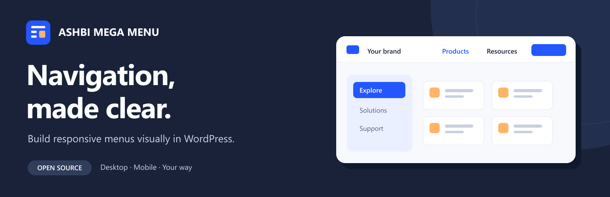
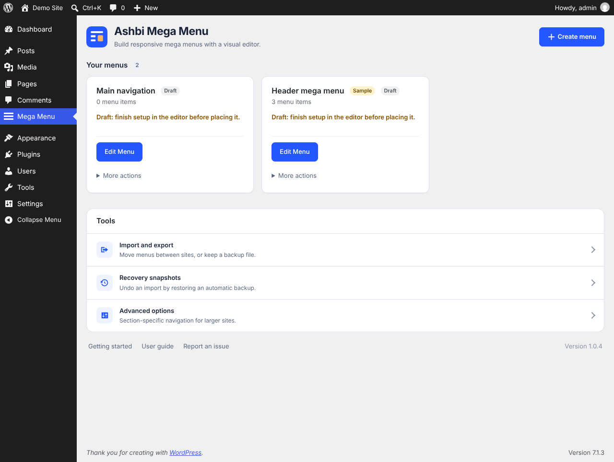

# Ashbi Mega Menu



An open-source WordPress plugin for building responsive navigation with a visual editor. Licensed under GPL-2.0-or-later.

**Status:** version 1.0.4 is the current release candidate for the existing WordPress.org submission under slug `ashbi-mega-menu`. Directory approval has not been granted.

[Release validation](https://github.com/camster91/ashbi-mega-menu/actions/runs/38441103680) covers the build, regression suite, official Plugin Check and WordPress database tests, including WordPress 6.6/PHP 8.2. See [security review](docs/security-review.md).

## Features

- Visual menus with categories, links, icons, calls to action and design presets.
- Desktop and mobile previews, plus optional browser-local mobile menu search.
- Shortcode, block and widget placement.
- Menu import, export and archives.
- Optional contextual navigation for products, services, departments, documentation or locations.
- Revision checks prevent a stale editor from silently replacing newer changes.

Activation starts with an empty menu list. An optional generic sample helps you get started; replace its placeholder links before using it. The plugin never automatically replaces your theme's header. New here? Read the [10-minute getting started guide](docs/getting-started.md), then [the user guide](docs/user-guide.md) for placement, duplicate-header prevention and recovery.

## Requirements and installation

WordPress 6.6 or later, PHP 8.2 or later, and a standard MySQL/MariaDB WordPress database. SQLite has not been tested.

Upload the release ZIP through **Plugins → Add New → Upload Plugin**, activate it, then open **Ashbi Mega Menu**. Create a menu and place it with the provided shortcode, block or widget. Test placement, keyboard navigation and mobile links on staging before enabling it on a client site.

Follow the [block-theme and classic-theme placement recipes](docs/user-guide.md#put-it-in-a-header). Chrome testing on a local WordPress installation covers the core create, edit, placement and responsive-navigation journey; see the [verification matrix](docs/compatibility.md) for its limits. Export menus and take a full-site backup before replacement imports or upgrades. Retained import backups restore the active menu collection; they do not restore header templates or the complete site.

This plugin uses independent `abmm_` storage and identifiers. It is a separate plugin, not an automatic migration or replacement for another menu plugin.

## Development

```sh
npm ci
npm run build:brand
npm run build:icons
npm run build
npm test
npm run test:php
npm run test:e2e   # needs a disposable WordPress site; see below
npm run package
```

Browser tests run the editor and the public menu in Chromium, Firefox and WebKit (Safari's engine). They need a disposable WordPress site: seed it with `wp eval-file tests/e2e/seed.php` (set `ABMM_DISPOSABLE_TEST=1`), install the browsers with `npx playwright install`, then set `WP_BASE_URL`, `WP_USERNAME` and `WP_PASSWORD` if they differ from the wp-env defaults. CI runs them on every push.

Use Node.js 24.18 or later and PHP 8.2 or later. Block source lives in `src/`; compiled files are in `build/`. Packaging uses an explicit runtime allowlist and produces `dist/ashbi-mega-menu-1.0.4.zip`. Build dependencies and CI configuration are available here, and are excluded from the install ZIP.

## Visual identity and directory assets

The original editable SVG artwork and palette are in [the brand kit](design/brand/README.md). Directory icons, banners and genuine local WordPress captures live in [.wordpress-org](.wordpress-org); see [asset deployment instructions](docs/wordpress-directory-assets.md). The banner uses a conceptual illustration. Directory publication remains pending review and approval.



CI builds the block, runs regression tests and invokes the official WordPress Plugin Check action against the packaged files. A successful CI run does not guarantee WordPress.org approval or compatibility with every theme.

## Privacy and removal

No telemetry, external updater or service account is included. Search runs in the visitor's browser. Administrators can enter external links or image URLs, which may cause visitor requests to those destinations. Deactivation retains plugin data; deleting the plugin removes its settings, menus, archives, profiles and branding. Export menus before deletion.

## Contributing and support

Developers can extend the plugin with documented hooks and front-end events; see [extending the plugin](docs/extending.md). See [CONTRIBUTING.md](CONTRIBUTING.md), [SECURITY.md](SECURITY.md), [THIRD-PARTY-NOTICES.md](THIRD-PARTY-NOTICES.md) and [support expectations](docs/support-policy.md). Report reproducible problems through [GitHub issues](https://github.com/camster91/ashbi-mega-menu/issues). Support has no guaranteed response time or SLA. Never include credentials, private menu exports or client information.
