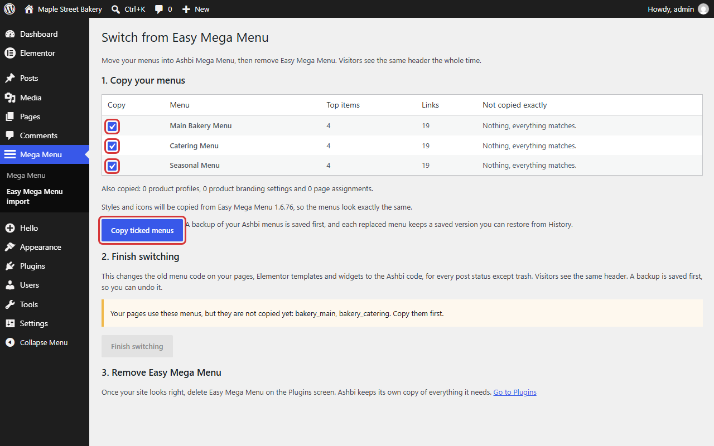
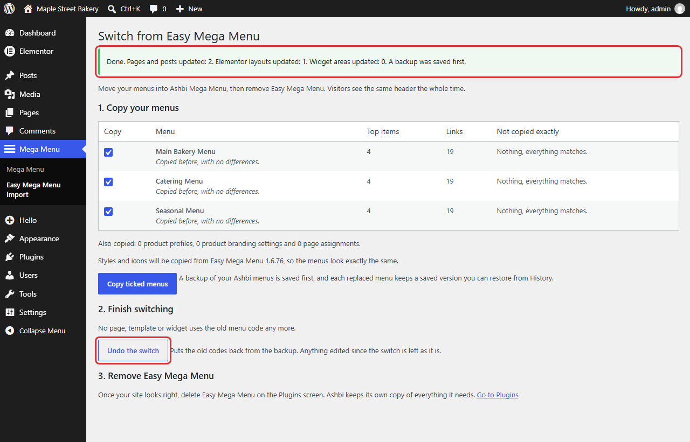

# Switch from Easy Mega Menu

You can move from Easy Mega Menu to Ashbi Mega Menu and then delete the old plugin. Your menus keep their look, and visitors see the same header the whole time.

## The simple way

Take a full backup of your site first. Then:

1. **Install** Ashbi Mega Menu. Keep Easy Mega Menu active. Your site doesn't change.
2. **Copy your menus.** Go to **Mega Menu**, then **Easy Mega Menu import**. Check the list, then click **Copy ticked menus**.
3. **Deactivate** Easy Mega Menu on the **Plugins** screen. Your headers keep working.
4. **Finish switching.** Go back to the same screen and click **Finish switching**.
5. **Check your site** while logged out, on a computer and a phone.
6. **Delete** Easy Mega Menu on the **Plugins** screen.

That's all. There is nothing to keep installed, and no setting to leave on.

## Step by step

### Before you start

1. Back up your database and your plugins folder.
2. Install and activate Ashbi Mega Menu with Easy Mega Menu still active. Your live pages stay the same.
3. If you use a cache or speed plugin that delays scripts, skip Ashbi's files the same way you skip Easy Mega Menu's. These are `ashbi-mega-menu/assets/classic/emm-frontend.js` and the stylesheet in `uploads/ashbi-mega-menu/classic/`. NitroPack is already told to skip them.

### Copy your menus

1. Open **Mega Menu**, then **Easy Mega Menu import**.
2. Read the table. It shows each menu's name, link count and **Not copied exactly**.
3. Leave a menu ticked to copy it.
4. Click **Copy ticked menus**.

**Not copied exactly** lists anything that won't carry over unchanged. For example, a setting Ashbi doesn't have, or a missing icon. "Nothing, everything matches" means the menu is an exact copy.

Your existing work is safe:

- A menu row is left **unticked** if an Ashbi menu already uses its ID, or if you edited the Ashbi copy. It stays as it is unless you tick it. Ticking it replaces your edits.
- A backup of your Ashbi menus is saved before each copy. You can restore it from **History**, under **All menus**.
- Each replaced menu keeps a version in its [History](undo-and-history.md).

You can copy again whenever you like. This refreshes what earlier copies made. Things you created yourself in Ashbi are kept unless you choose to replace them. If anything is kept or fails, the screen tells you which and why.

### What gets copied

| In Easy Mega Menu | In Ashbi Mega Menu |
| --- | --- |
| Menus and their IDs | Menus with the same IDs and the same look |
| Product profiles | Product Navigation, with main pages and buttons |
| Product branding | Product Branding, with product names and logos |
| Page assignments | Page assignments. Yours are kept. |
| Stylesheet and icons | Copies in `wp-content/uploads/ashbi-mega-menu/classic/` |

Branding copies only when its menu was also copied. If Easy Mega Menu's files can't be found, Ashbi uses its own styles and plain icons. The screen tells you before you copy.

### Finish switching

Do this after you deactivate Easy Mega Menu. The button stays off until then, and until every menu your pages use has been copied.

**Finish switching** changes the old `[easy_mega_menu]` code to `[ashbi_mega_menu]` in these places:

- pages, posts and templates, in every status except trash
- Elementor layouts
- widgets

It saves a backup first. It also clears the files Elementor generated, so they are built again. When it's done, it tells you how many places it changed.

The header doesn't change, because both codes show the same menu.

**To undo it:** click **Undo the switch** on the same screen. This puts the old codes back. If you edited a page after the switch, that page stays as it is, and the screen tells you how many were left.

### Delete Easy Mega Menu

Once your site looks right, go to **Plugins** and delete Easy Mega Menu. Ashbi has its own copy of everything it needs.

Then the **Easy Mega Menu import** item leaves the **Mega Menu** sidebar. If you need the screen again, it's under **Tools**, then **Easy Mega Menu switch**.

## If you missed a code

If a page still has the old code, it keeps working. This covers trashed pages you restore later, an old revision, or a theme that uses the code. Ashbi quietly shows the same menu, so a visitor never sees the code as text. There is nothing to turn on.

A theme that calls `emm_render_menu()` keeps working in the same way.

**If a warning appears:** your pages use a menu that you haven't copied. Its header is empty until you copy it. The warning names the menu and links to the screen. Copy the menu while Easy Mega Menu's data is still on your site.

## What visitors will notice

Your closed menus look the same as before. These parts improved on purpose, so you may see them:

- Panels open after a short pause, and they close sooner.
- A click on a label keeps its panel open.
- On phones, tapping a link closes the drawer.
- On phones, long lists scroll to their last link. In Easy Mega Menu, the last links could sit off the screen.
- On phones, rows fill the width of the drawer, and **Back** has a label.
- Long single lists can flow into two columns, and panels stay within the menu bar's width.

These fixes come from a small extra file, `emm-fixes.css`. It works without copying again. If you changed the look with your own styles, check them on your site.

## Keep or change the look

Copied menus keep the look they had. They use the same code and styles as before, so your site's own styles keep working. Your own icons stay too.

Color, size and width changes in **Design** still apply.

To move a menu to Ashbi's own style:

1. Click **Design** and open **Advanced settings**.
2. Set **Site look** to **Use the Ashbi look**. If the menu is on your site, you're asked to confirm.
3. Save. Visitors see the new look right away.

To undo it, set it back to **Keep the current look** and save.

### Options for these menus

- **Phone menu button label.** Tells two phone menus apart. See [Phone menus](phone-menus.md#phone-menu-button-label).

Developers have more choices. See [Extending the plugin](extending.md#rendering).

### The preview

The previews show the look your site uses, on every screen size. They don't load your theme's styles, so check the final look on your site.

## Removing a menu you don't use

Use **Archive**. The menu leaves your site and stops being a choice in the block, widget and Elementor lists. You can bring it back from **Archived menus** at any time. See [Undo and history](undo-and-history.md).

## If you delete Ashbi Mega Menu

Your menus stay in the database, and they come back if you install the plugin again. To remove them when you delete the plugin, turn on **Delete all data when the plugin is deleted**. It's in **Tools**, under **If you delete this plugin**.
