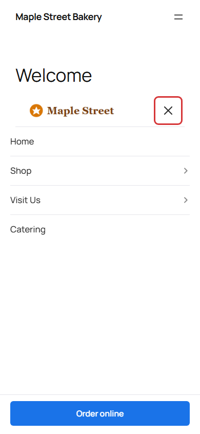
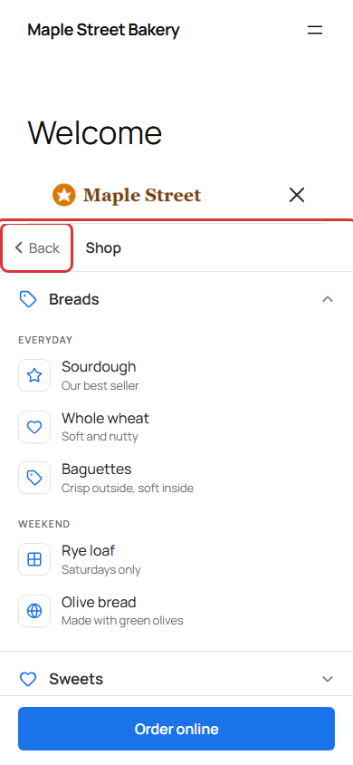
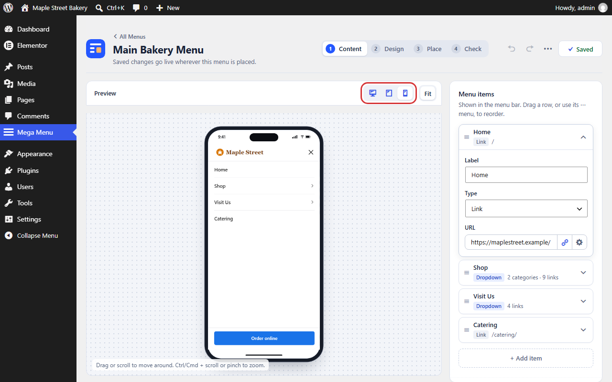
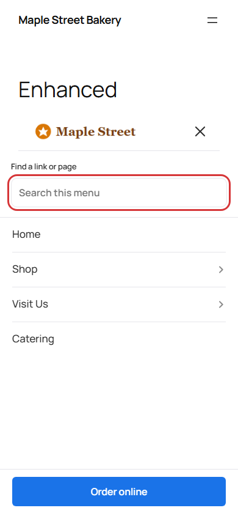
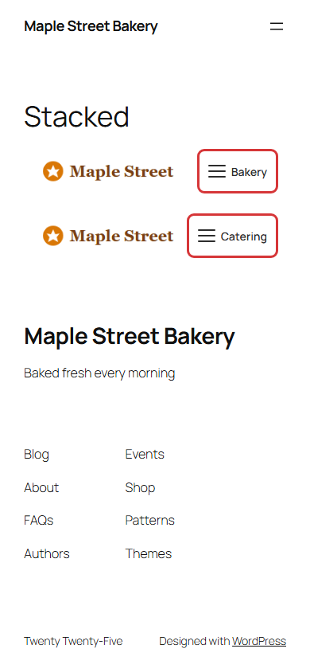

# Phone menus

## The simple way

You don't have to set anything up. Every menu works on phones by itself.

On screens up to 900 pixels wide, your menu bar becomes a menu button. Tapping it slides open a panel called a drawer.

Your visitors do this:

1. Tap the menu button.
2. Tap a section to see its links.
3. Tap a link to go to that page. The drawer closes by itself.
4. Tap **Back** to go up a level, or tap **Close** to leave.

## Check it in the preview

1. Click the phone button above the preview.
2. Open the menu and tap through it, as a visitor would.

Then check on a real phone, once the menu is on your site. The preview does not load your theme's styles.

## Writing for small screens

- Keep labels short. Long labels are hard to read and tap.
- Don't put too many links in one section.
- Put the most used links first.
- Your button also shows in the drawer, so visitors can still find it.

## Why a big screen can show the phone menu

The menu looks at the space it has, not just the screen. In a narrow column or sidebar, it may show the phone menu even on a large screen. To fix this, give it the full page width.

Very full menu bars can also switch to the phone menu on a desktop screen. This stops the links from running over each other. Shorter labels or fewer items can fix it.

## Options

### Enhanced mobile menu

This option adds three things to the phone menu:

- A search box, which finds links in your menu. The search runs on the visitor's device and sends nothing to anyone.
- Rows that fill the full width of the drawer.
- The word "Back" next to the back arrow.

To turn it on, click **Design** and open **Advanced settings**. Then open **Mobile navigation** and turn on **Enhanced mobile menu**. Save when you are done.

Use it if your menu has many links. It is off by default.

### Phone menu button label

This is for menus imported from Easy Mega Menu. It is useful when a page shows two menus, because a phone then shows two menu buttons that look the same.

Open **Advanced settings**, then **Mobile navigation**. Type a short word such as "Products" in **Phone menu button label**. Visitors will see it next to the button. Screen readers will read it out too.

Leave it empty to show just the icon. That's the default.

### Stacking two menus

If you show two menus on one page, set the second menu's **Header stacking order** lower than the first. This keeps the main menu on top when it opens. You will find this setting in [Style your menu](style-your-menu.md#layout-and-style).

## On menus from Easy Mega Menu

Long submenus used to hide their last links on phones. This is now fixed for every menu. Visitors can scroll to the last link.

See [Switch from Easy Mega Menu](migrate-from-easy-mega-menu.md) for more.

## Test on a real device

Before you remove your old menu, try these on a real phone:

- The menu button opens the drawer.
- Each section opens, and **Back** works.
- Tapping a link goes to the right page and closes the drawer.
- **Close** works.
- The page behind doesn't move while the drawer is open.

If you have a problem, see [Fix a problem](troubleshooting.md).
