# User guide

This guide covers every feature and option. New here? Start with [Get started](getting-started.md).

Each topic starts with what most people need. Advanced options come after that. You can skip them unless you need them.

## How the plugin works

You do three things:

1. **Build** a menu in the editor.
2. **Save** it.
3. **Place** it on your site.

**Saving is how changes go live.** There is no draft state and no publish button. Once a menu is on your site, each save updates your site right away. A menu that isn't placed yet can't be seen by visitors.

Creating a menu never changes your theme's header. You choose when and where the menu shows.

## Words used in this guide

- **Menu bar:** the row of links across the top of your site.
- **Item:** one entry in the menu bar.
- **Dropdown:** an item that opens a panel of links.
- **Panel:** the box that opens from a dropdown.
- **Drawer:** the panel that slides open on a phone.
- **Shortcode:** a short piece of text that WordPress swaps for your menu.
- **URL:** a web address.

## The main screen

Click **Mega Menu** in the WordPress sidebar. This screen lists your menus.

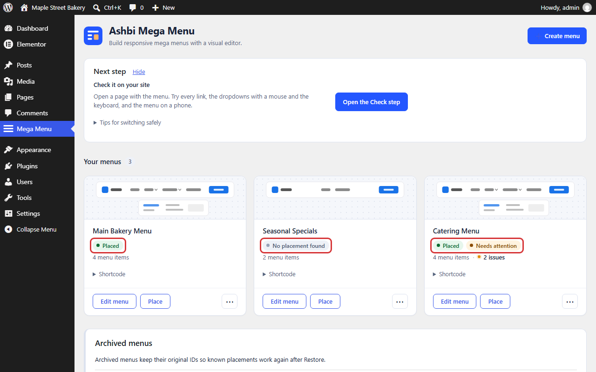

### Next step

The **Next step** card shows the one thing to do now, with a button that takes you there. It moves on by itself when the plugin can see a step is done. Placed your menu in a theme file? The plugin can't see that, so click **Already placed it? Check it on your site**.

The last step is yours. On the **Check** step, click **I've checked it** when your menu works. Changed your mind? Click **Mark as not checked**.

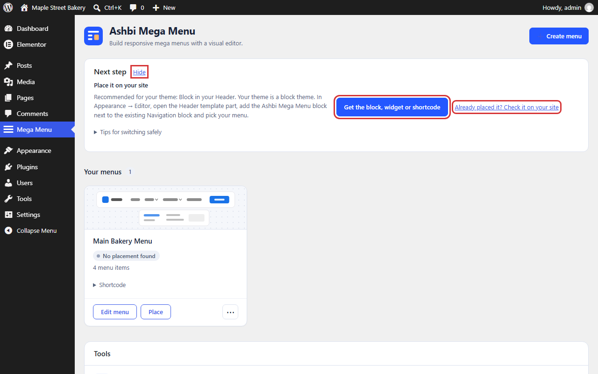

Click **Hide** to close the card. Click **Show setup guide** at the bottom of the screen to bring it back.

### Menu cards

Each menu has a card. A card can show these labels:

- **Placed:** the plugin found this menu on your site. Each save updates it there.
- **No placement found:** the plugin did not find it. A menu in a theme file can still be live, because the plugin can't look inside theme files.
- **Needs attention:** the checklist found something to fix. The menu may still be live.
- **Sample:** this menu started from the template. Replace its words and links.
- **Empty menu:** this menu has no items yet.

Click **Shortcode** on a card to see its shortcode and a **Copy** button.

Card buttons:

- **Edit menu** opens the editor. On an unfinished menu, it says **Finish setup**.
- **Place** opens the **Place** step.
- **⋯** opens more actions, shown below.

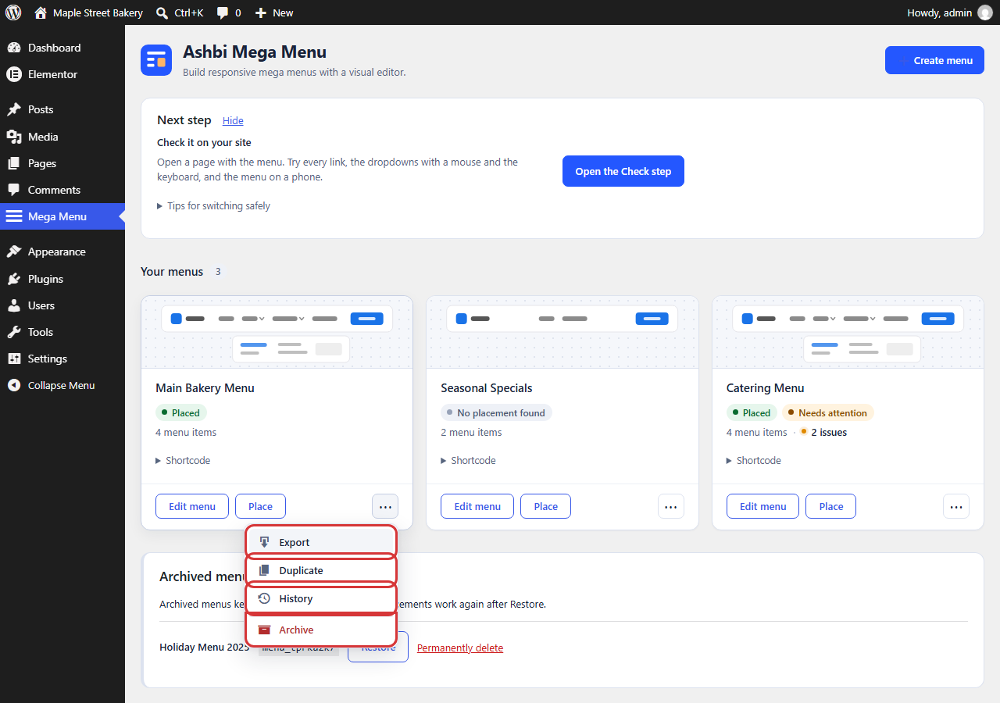

- **Export:** save this menu as a file.
- **Duplicate:** make a copy to work on.
- **History:** go back to an earlier version.
- **Archive:** take the menu out of use, and keep it.

With more than six menus, you also get a search box, a sort list and a choice of grid or list view.

### Tools

**Tools** sits at the bottom of the main screen.

- **Import and export:** move menus between sites, or keep a backup file. See [Undo mistakes](undo-and-history.md#import-a-file).
- **Import from WordPress menu:** start from a menu you already built. See [Start from a WordPress menu](#start-from-a-wordpress-menu).
- **History:** go back to an earlier version of one menu, or restore a backup of all menus. See [Undo mistakes](undo-and-history.md).
- **Product Navigation:** turn on extra links for separate parts of your site. See [Product Navigation](#product-navigation).

## Create a menu

When you have no menus, you can start three ways:

- **Start from your pages.** Tick the pages you want. Top-level pages are ticked for you. Each child page goes in its parent's dropdown. Only published pages are listed.
- **Use a template.** You get a sample menu. Replace all its words and links.
- **Start from scratch.** You get an empty menu.

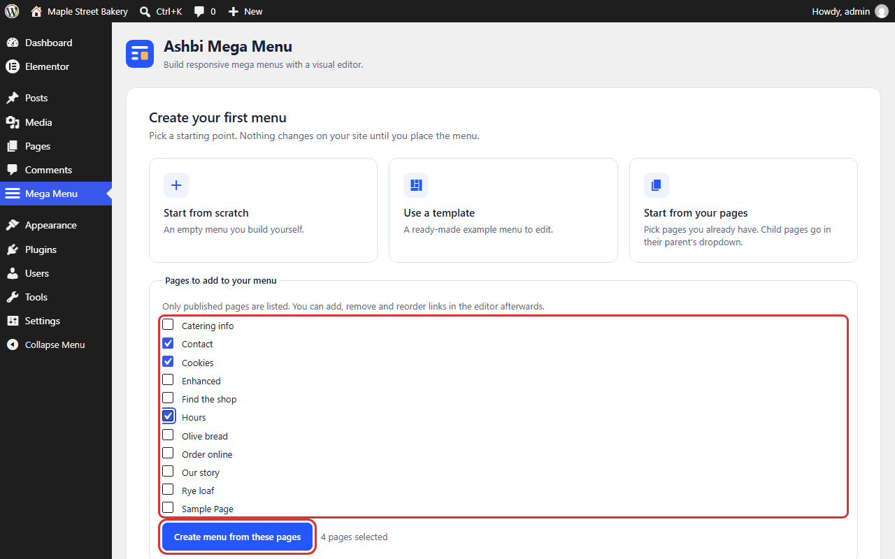

Later, use **Create menu** at the top of the main screen.

### Start from a WordPress menu

If you built a menu in WordPress, you can start from it.

1. Go to **Tools**, then **Import from WordPress menu**.
2. Pick the menu and click **Preview**. Nothing is saved yet.
3. Read the preview, then import it.

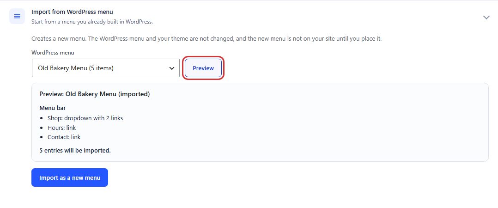

This creates a new menu. It doesn't change your WordPress menu or theme, and it isn't on your site until you place it. See [Import a WordPress menu](import-wordpress-menus.md) for the details.

## The editor

The editor has four steps along the top. Work through them in order, or jump to any of them.

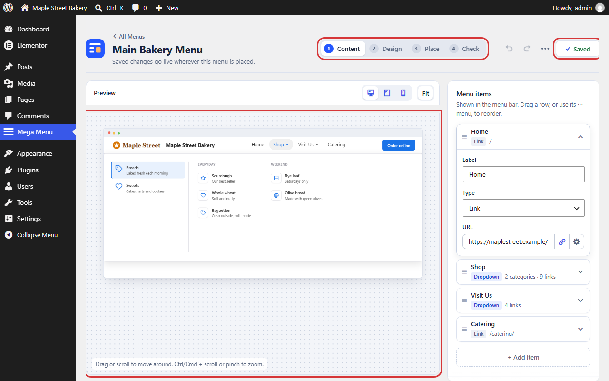

- **Content:** your links, button and logo.
- **Design:** how the menu looks.
- **Place:** how to add it to your site.
- **Check:** what to test.

At the top you will also find:

- **The menu name.** Click it to rename the menu. Visitors do not see it on the page, but screen readers read it out.
- **Undo and Redo.** See [Undo mistakes](undo-and-history.md).
- **⋯.** Opens more actions, such as **History** and **Export as JSON**.
- **The save button.** It says **Save changes**. On a placed menu it says **Save and update site**.

Next to it, a status tells you whether your changes are saved. Once they are, it also says **Live where placed** or **No placement found**. Press **Ctrl+S** or **Cmd+S** to save with your keyboard.

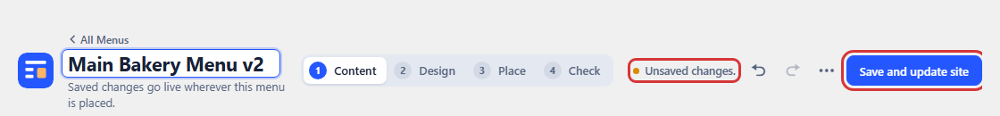

### Find the editor from your site

When you're logged in, pages with a menu show **Edit mega menu** in the top toolbar. Click it to open that menu. If a page has more than one menu, pick one from the list.

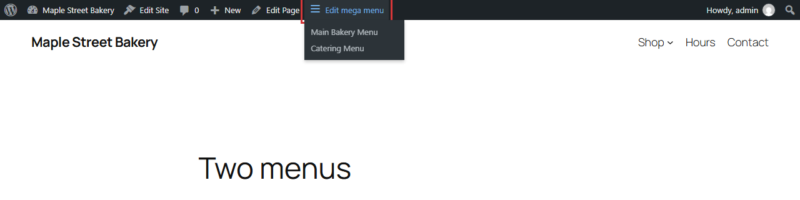

## Content

### Menu items

Click **Add item** to add an item. Each row has these options:

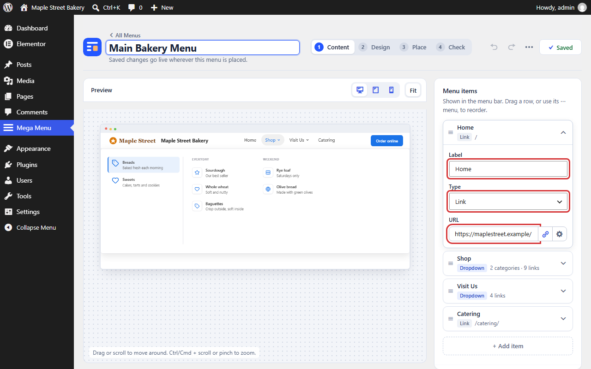

- **Label.** The words people see. Keep it short. Long labels will be flagged by the checklist.
- **Type.** Choose **Link** or **Dropdown**. Default: **Link**.
- **URL.** Shown for a **Link**. Click the link button to search your pages, or type an address.
- **Edit content.** Shown for a **Dropdown**. Opens the dropdown's links.
- **More options, then Page for this dropdown.** Optional. Most dropdowns leave this empty. If it has a value, **More options** opens by itself. The item shows as the current page there, and people whose browser has scripts turned off get a link to it.

Row buttons let you reorder, duplicate or remove an item. You can also drag the handle on the left.

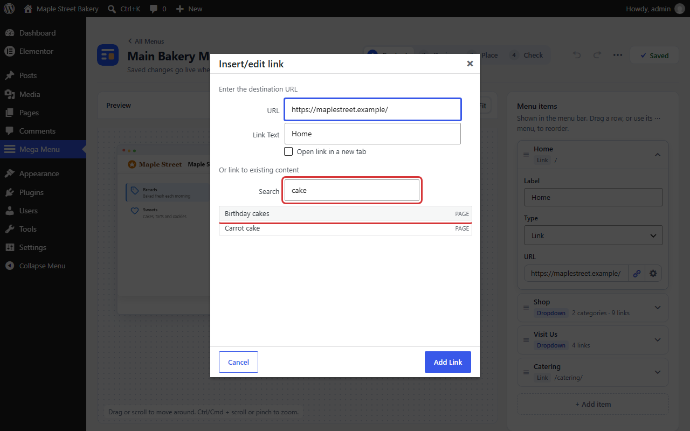

### Dropdown content

Click **Edit content** on a dropdown. Then choose a layout.

**Simple columns** is what most menus need. It's also the default. Your links sit in 1 to 4 columns.

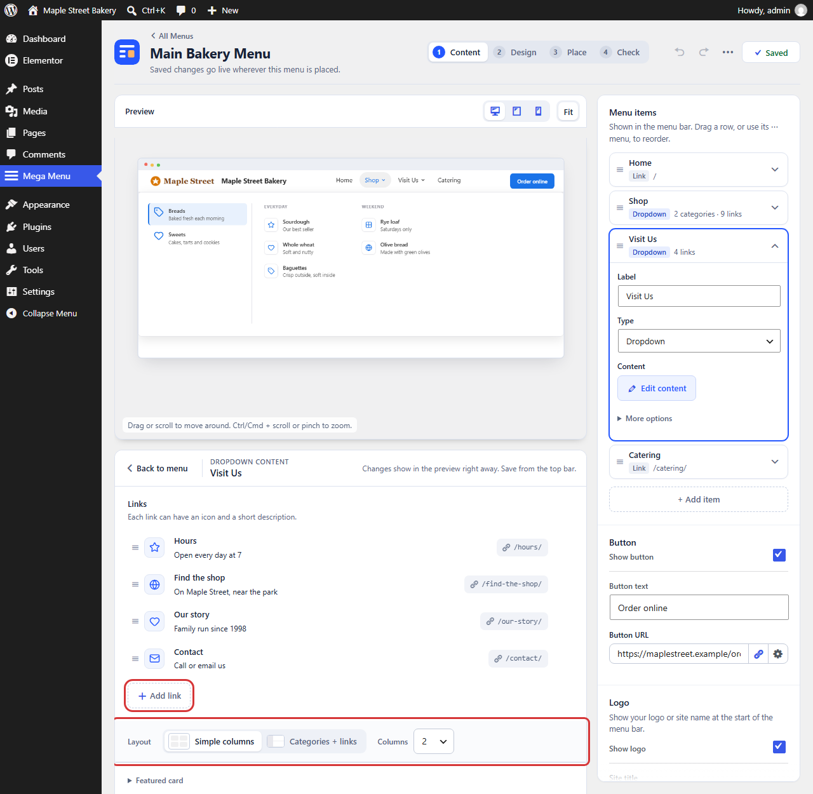

- **Columns.** How many columns to use. Default: 2 for a new dropdown.
- **Add link.** Adds a link to the panel.

**Categories + links** is for large menus. A list of categories sits on one side. Pointing at one shows its links.

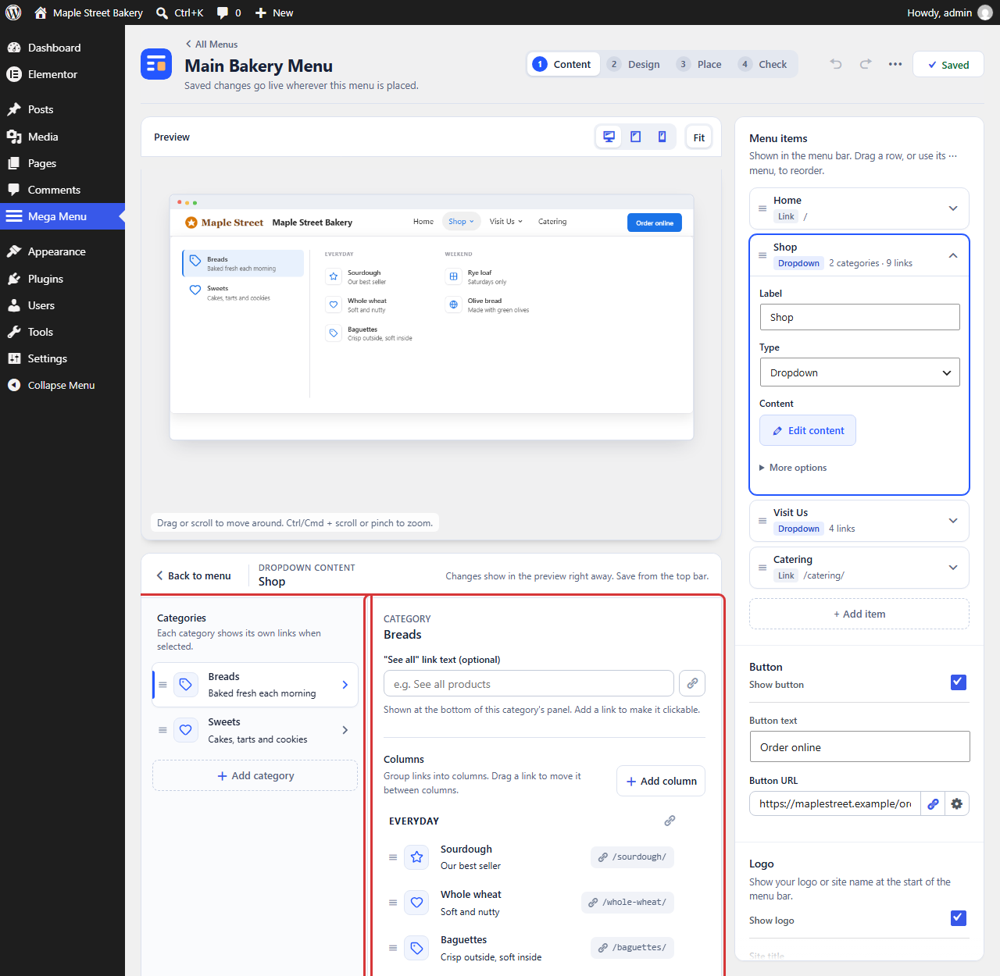

Use it when you have many links that fall into clear groups. Each category has:

- **Icon.** Optional. Click it to choose one.
- **Title.** The category's name.
- **Description.** One short line under the title. Optional.
- **Panel title.** An optional heading above the category's links. You can also make it a link, such as "See all".
- **Columns.** Click **Add column** to group links. Each column can have a heading, and that heading can be a link. Drag a link to move it to another column.

Under **More options**, **Hide the category bar** removes the list of categories and uses the full width for columns. It only shows when it can apply.

### Links in a dropdown

Each link can have:

- **Icon.** Optional. See [Icons](#icons).
- **Label.** The words people see.
- **Description.** A short line under the label. Optional.
- **Link.** Click the link chip to set the address.

### Link options

Click the gear next to a link to see its options.

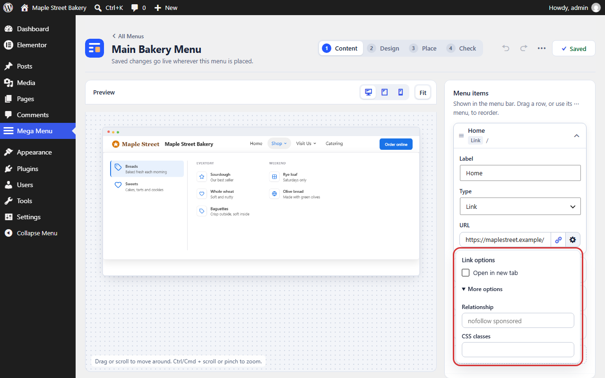

- **Open in new tab.** Opens the link in a new tab. Use it for links to other sites. Screen readers will say that it opens a new tab. Default: off.

Most people never need the next two, so they sit under **More options**. If one has a value, **More options** opens by itself. The button shows them without that step.

- **Relationship.** Tells search engines about a link. For example, type `nofollow sponsored` for a paid link. Default: empty.
- **CSS classes.** Extra names for styling with your own code. Leave this empty unless a developer asks you to fill it in. Default: empty.

### Icons

Click a row's icon spot to open the icon window.

- **Search icons.** Type a word to find an icon.
- **Upload custom icon.** Use your own picture.
- **Clear icon.** Removes the icon.
- **More options, then Icon style for this item.** Changes this one icon only. Use **Reset to menu style** to undo it.

### Featured card

A featured card is an optional highlight at the end of a panel. Use it for a launch, a guide or an offer. It sits in a closed section at the bottom of the dropdown editor. The section opens by itself if the card has anything in it.

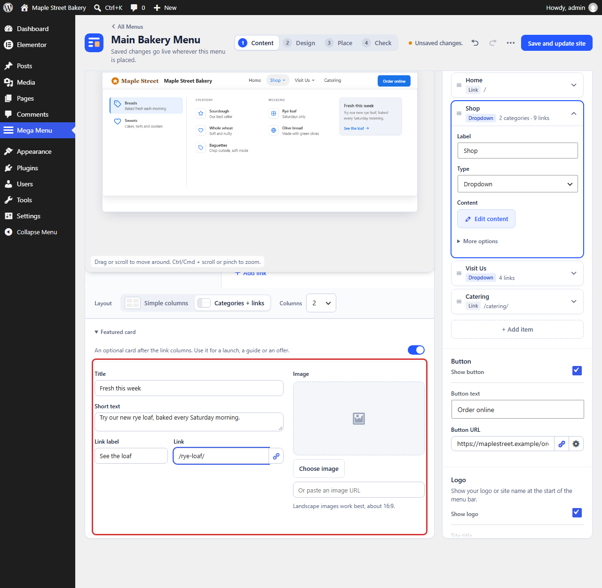

- **Show a featured card.** Turns the card on. Default: off.
- **Title.** The heading on the card.
- **Short text.** One or two lines about it.
- **Link label.** The words on the link, such as "Learn more".
- **Link.** Where it goes.
- **Image.** Choose an image or paste its address. Wide images work best, at a shape of about 16 by 9.

### Button

The button stands out at the end of the menu bar. Use it for your main action, such as "Book a demo".

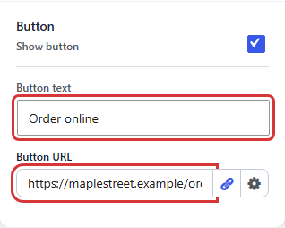

- **Show button.** Turns it on or off.
- **Button text.** The words on the button.
- **Button URL.** Where it goes.

You can change its colors and shape in [Style your menu](style-your-menu.md).

### Logo

Show your logo or site name at the start of the menu bar.

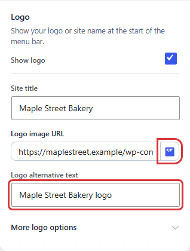

- **Show logo.** Turns it on. Default: off.
- **Logo image URL.** Click the picture button to choose from your Media Library.
- **Logo alternative text.** Words that screen readers read out. You will see a warning if you leave this and the site title empty.

Click **More logo options** for the rest. See [Style your menu](style-your-menu.md#logo-details).

## The preview

The preview shows your menu as you work. Menus open as they do on your site. Click an item in the preview to select it in the editor.

Click **Desktop**, **Tablet** or **Mobile** above it to change the size.

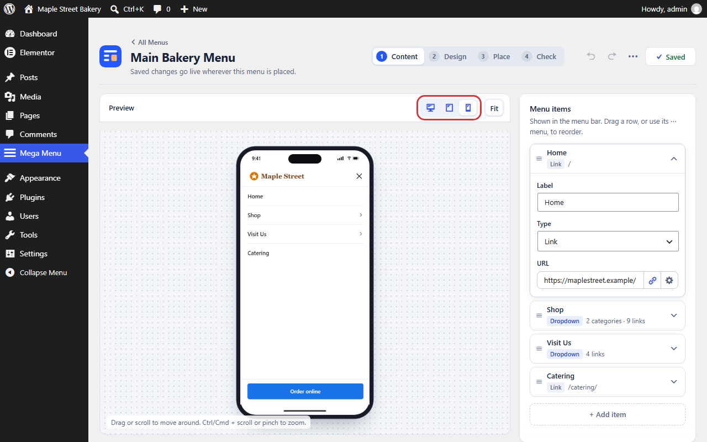

**The preview doesn't load your theme's styles.** Always check the final look on your site.

### Move and zoom

These help on a large menu. Each device remembers its own zoom in your browser.

- **Fit** fits the menu to the space. Press **Ctrl+1** or **Cmd+1** to see it at full size.
- To move around, drag an empty spot or scroll with two fingers.
- To zoom, hold **Ctrl** or **Cmd** and scroll, or pinch.

## Design

Most people only need a style. The full list is in [Style your menu](style-your-menu.md).

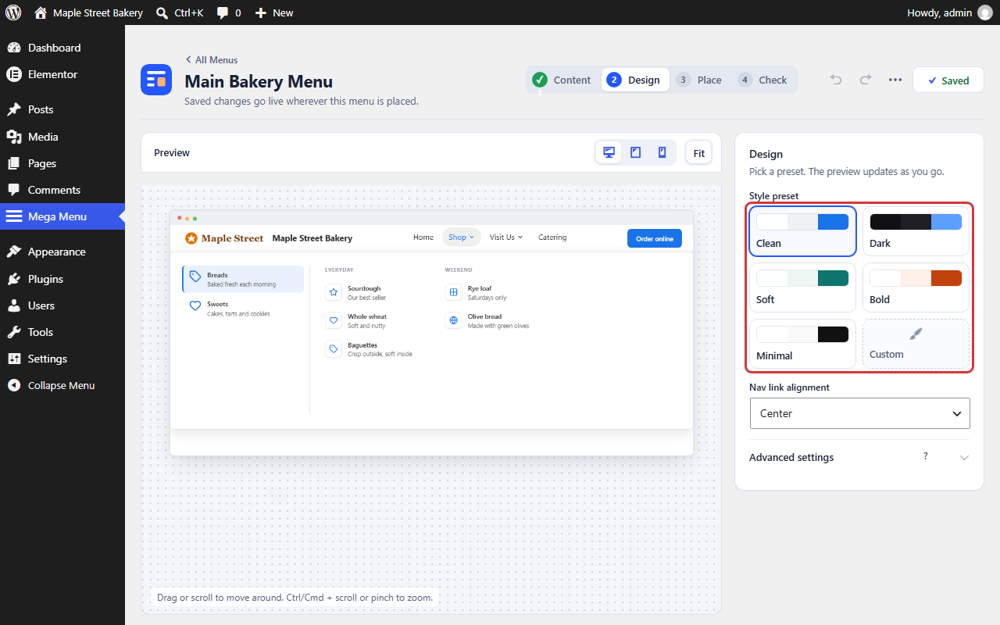

**Site look** shows only on menus imported from Easy Mega Menu. See [Switch from Easy Mega Menu](migrate-from-easy-mega-menu.md#keep-or-change-the-look).

## Place and Check

See [Place your menu](place-your-menu.md).

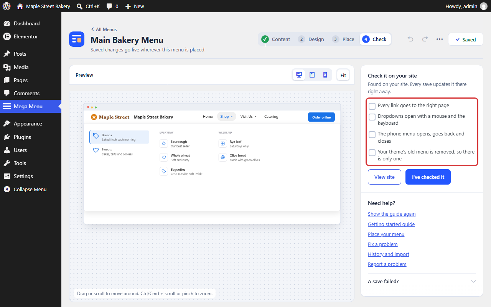

### Checklist

The checklist is at the top of the **Place** step, so you can fix things before you place the menu. A small number on that step shows how many things it found. It looks for things to fix, such as links that go nowhere. Click an item to jump to the problem.

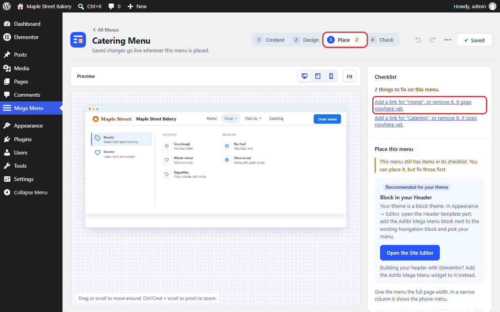

It doesn't test your links, your theme or how easy the menu is to use. The full list is in [Fix a problem](troubleshooting.md#my-menu-card-says-needs-attention).

## Phone menus

See [Phone menus](phone-menus.md).

## Elementor

The menu comes with its own Elementor widget. See [Place your menu](place-your-menu.md#elementor).

These Elementor settings are extra to the settings in **Design**:

- **Menu.** Which menu to show.
- **Show Product Navigation on product pages.** Shows product links. See below.
- **Style tab.** Sets fonts and colors for the menu bar, category titles, links and descriptions. It also sets the dropdown background and height.

## Product Navigation

Most sites don't need this. It's off by default.

**What it does:** it shows extra links under your main menu on a product's pages. For example, an "Analytics" page and all the pages under it can show Overview, Features and Pricing links. It works for services, departments or locations too.

**To turn it on:**

1. Go to **Tools**, then **Product Navigation**.
2. Tick **Turn on Product Navigation**.
3. Click **Save this setting**.

**To add a product:**

1. Open **Product Navigation**.
2. Fill in the form. Add up to six links.
3. Click **Add product**.
4. Turn it on where the menu is placed. See [Place your menu](place-your-menu.md#show-extra-links-on-product-pages).

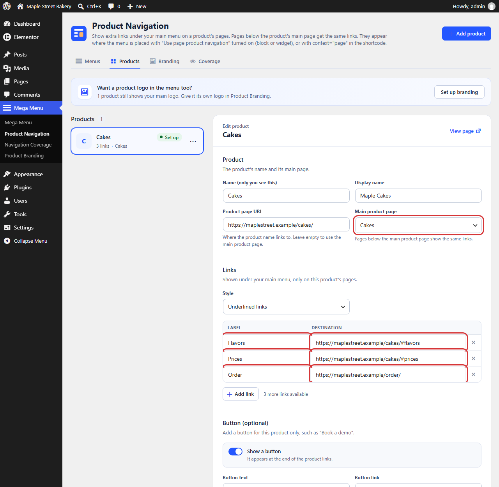

Product options:

- **Name (only you see this).** Helps you find the product.
- **Display name.** The name visitors see.
- **Product page URL.** Where the product name links to. Leave it empty to use the main product page.
- **Main product page.** The product's main page. Pages under it show the same links.
- **Style.** **Underlined links** or **Pill links**.
- **Links.** Each has a label and a destination.
- **Show a button.** A button for this product only, with its own text and link.

A card's label tells you where the product stands:

- **Set up:** it's ready to show.
- **No links yet:** add at least one link.
- **No main page:** choose a main page.

**Delete** on a product also deletes its branding. You can't undo it.

### Product branding

This shows a product's own logo in the menu, on that product's pages.

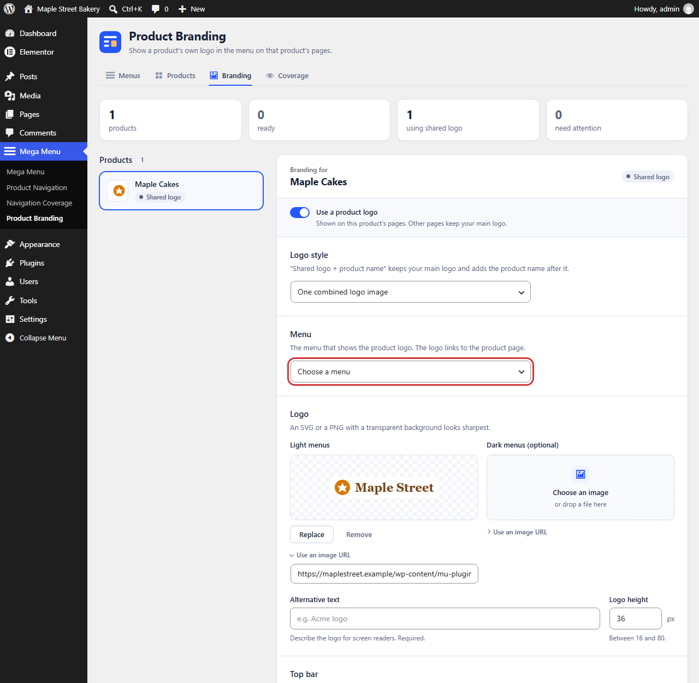

- **Use a product logo.** Turns it on for this product.
- **Logo style.** **One combined logo image** or **Shared logo + product name**. The second keeps your main logo and adds the product's name after it.
- **Menu.** The menu that shows this logo.
- **Logo.** An image for light menus. You can also add one for dark menus.

### Navigation coverage

This page lists which product links each page shows. Use it to check your setup. You can search it and filter it.

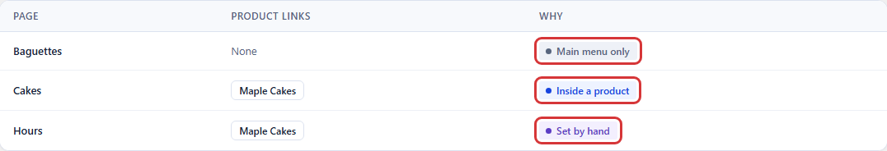

The **Why** column tells you the reason:

- **Inside a product:** the page sits under a product's main page.
- **Set by hand:** someone chose a product for this one page.
- **Main menu only:** the page isn't part of a product.

### One page that needs a different product

Pages normally follow their main product page. If one page is an exception, open that page in the WordPress editor. In the **Ashbi Mega Menu context** box, choose a product.

### Test it

Check three pages: the product's main page, a page under it and a page outside it. Exports don't include products or branding.

## Move menus between sites

See [Undo mistakes](undo-and-history.md#export-a-copy).

### Command line tools

This part is for developers. WP-CLI is a tool for running WordPress from a command line.

```sh
wp abmm export > /safe/private/path/menu-backup.json
wp abmm import --file=/safe/private/path/menu-backup.json --mode=copy --dry-run
wp abmm import --file=/safe/private/path/menu-backup.json --mode=copy
```

Keep export files outside your public web folder. On a shared server, set strict file permissions first, such as `umask 077`. The export command's old `--file` option no longer works, so send the output to a file as shown above.

Your site also lists its REST API addresses in **Tools**, under **Import and export**. For more on hooks and other developer tools, see [Extending the plugin](extending.md).

## Switch from Easy Mega Menu

See [Switch from Easy Mega Menu](migrate-from-easy-mega-menu.md).

## Turning off or deleting the plugin

- **Deactivating** turns the plugin off and keeps all your menus. Spots that show a menu go empty.
- **Deleting** removes your menus, archived menus, History, products, branding and settings. Export your menus first if you might want them.

## More help

- [Fix a problem](troubleshooting.md)
- [What has been tested for accessibility](accessibility.md)
- [Which themes have been tested](compatibility.md)
- [How to get support](support-policy.md)
